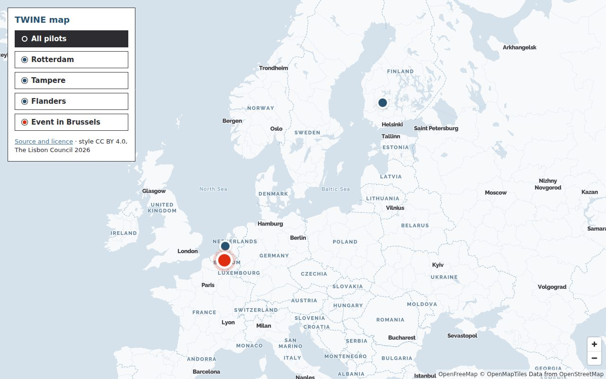

# TWINE map style for MapLibre GL

[](LICENSE)
[](LICENSE-CODE)

A vector map style for [MapLibre GL JS](https://maplibre.org/) in the visual identity of [TWINE](https://twine-project.eu/): brand palette, Raleway and Albert Sans labels, and markers in the style of the TWINE website.

Base map tiles come from [OpenFreeMap](https://openfreemap.org/) (OpenMapTiles schema, OpenStreetMap data). No account, no API key, no per-load cost.

**Live preview:** https://lisboncouncil.github.io/twine-map-style/



## Quick start

Use the published style directly. Glyphs and style are served from GitHub Pages.

```html
<link rel="stylesheet" href="https://cdn.jsdelivr.net/npm/maplibre-gl@5/dist/maplibre-gl.css">
<script src="https://cdn.jsdelivr.net/npm/maplibre-gl@5/dist/maplibre-gl.js"></script>

<div id="map" style="height: 320px"></div>
<script>
  const map = new maplibregl.Map({
    container: 'map',
    style: 'https://lisboncouncil.github.io/twine-map-style/twine-style.json',
    center: [4.3786, 50.8433],
    zoom: 15
  });

  // A TWINE venue marker: Red Orange dot with a white ring
  const el = document.createElement('div');
  el.style.cssText = 'width:26px;height:26px;border-radius:50%;background:#df2e10;border:4px solid #fff;box-sizing:border-box';
  new maplibregl.Marker({ element: el }).setLngLat([4.3786, 50.8433]).addTo(map);
</script>
```

In production, consider serving `maplibre-gl.js` and `maplibre-gl.css` from your own site instead of the CDN.

## Repository layout

| Path | What it is |
| --- | --- |
| `style/twine-style.json` | The style (MapLibre style spec v8), with glyphs pointing to GitHub Pages |
| `fonts/` | Glyph files (PBF) for Raleway Bold, Raleway ExtraBold, Albert Sans Regular and Albert Sans SemiBold |
| `preview/index.html` | The preview page published as the site home |
| `scripts/make_style.py` | Generates the style; colours, fonts and layers are defined here |
| `scripts/instance_fonts.py` | Creates static font instances from the variable fonts |
| `scripts/gen-glyphs.js` | Turns a TTF into MapLibre glyph PBFs (uses `fontnik`) |
| `docs/preview.jpg` | Screenshot used in this README |
| `build.sh` | Builds the static site in `_site/` |
| `.github/workflows/` | Publishes to GitHub Pages on every push to `main`; validates the style on pull requests |

## Working on the style

Edit `scripts/make_style.py`, then regenerate and validate:

```bash
npm install
python3 scripts/make_style.py      # writes style/twine-style.json
npm run validate
```

Test locally with glyphs served from your machine:

```bash
./build.sh http://localhost:8765
python3 -m http.server 8765 -d _site
# open http://localhost:8765/
```

Commit both `scripts/make_style.py` and the regenerated `style/twine-style.json`. The pull request check fails if they are out of sync.

### Regenerating the glyphs

Only needed if fonts change. Download the variable fonts from Google Fonts ([Raleway](https://fonts.google.com/specimen/Raleway), [Albert Sans](https://fonts.google.com/specimen/Albert+Sans)), then:

```bash
pip install fonttools
mkdir -p ttf
python3 scripts/instance_fonts.py Raleway-VF.ttf AlbertSans-VF.ttf ttf
for f in "Raleway Bold" "Raleway ExtraBold" "Albert Sans Regular" "Albert Sans SemiBold"; do
  node scripts/gen-glyphs.js "ttf/${f// /_}.ttf" "$f" fonts
done
```

## Design notes

- **Palette.** Land `#f7f9fb`, residential areas Mist `#eef3f7`, water `#d5e2ec`, parks `#fcebe7`, buildings `#e8eef3`, roads white with Light Steel Blue casing, boundaries in Air Blue, country labels in Slate Blue. Derived from the TWINE Visual Identity Guideline 2026: Slate Blue `#285271`, Steel Blue `#487a9f`, Air Blue `#75a0c0`, Light Steel Blue `#aac5d8`, Red Orange `#df2e10`, Melon Orange `#f47d69`, Pastel Peach `#f8b0a3`, Guide Ink `#2c2c31`.
- **Labels.** English names where available (`name:en`), otherwise the local name in Latin script. Street names stay in the local language. Cities in Raleway ExtraBold, countries in Raleway Bold, everything else in Albert Sans, as in the guideline (Raleway for titles, Albert Sans for text).
- **Quiet base map.** Points of interest, shop icons, road shields and one-way arrows are hidden on purpose, so that project content stands out. The cool, light ground leaves Red Orange to the markers.
- **Markers.** A dot with a white ring: Slate Blue for the pilots (Rotterdam, Tampere, Flanders), a larger Red Orange dot for event venues, as on the event pages of the TWINE website. Coordinates in the preview are approximate: city centres, and the middle of the region for Flanders.

## Privacy

OpenFreeMap requires no account or API key and does not use tracking. GitHub Pages, which serves the style and glyphs, may log IP addresses for security purposes. Check both with your data protection officer before use.

## Attribution

The attribution "OpenFreeMap © OpenMapTiles, Data from OpenStreetMap" is required. It is set in the style source, and MapLibre shows it on the map.

## Licence

- **Style and design** (`style/`, the map design in `scripts/make_style.py`, the preview page design and this documentation): [Creative Commons Attribution 4.0 International (CC BY 4.0)](LICENSE). © The Lisbon Council 2026.
- **Code** (`scripts/`, `build.sh`, workflows, the JavaScript in `preview/index.html`): [MIT](LICENSE-CODE). © 2026 The Lisbon Council.

Suggested attribution when reusing the style: *"TWINE map style" by The Lisbon Council, CC BY 4.0, https://github.com/lisboncouncil/twine-map-style*

Third-party components keep their own licences:

- Glyph files in `fonts/` are derived from Raleway and Albert Sans, both released under the [SIL Open Font License 1.1](https://openfontlicense.org/).
- Map data © [OpenStreetMap contributors](https://www.openstreetmap.org/copyright), available under the Open Database License (ODbL). Tiles by OpenFreeMap and OpenMapTiles.
- MapLibre GL JS is released under the BSD 3-Clause licence.

## Citation

See [`CITATION.cff`](CITATION.cff).

## Funding

TWINE (Twin-based Web Interoperable Network for Engagement) has received funding from the European Union's Horizon Europe Framework Programme under Grant Agreement No. 101298722. Views and opinions expressed are however those of the author(s) only and do not necessarily reflect those of the European Union. Neither the European Union nor the granting authority can be held responsible for them.
